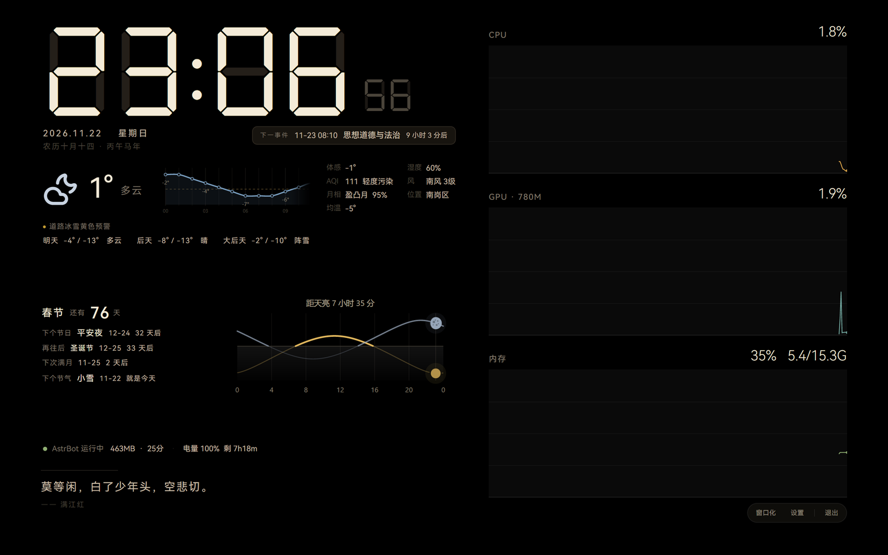
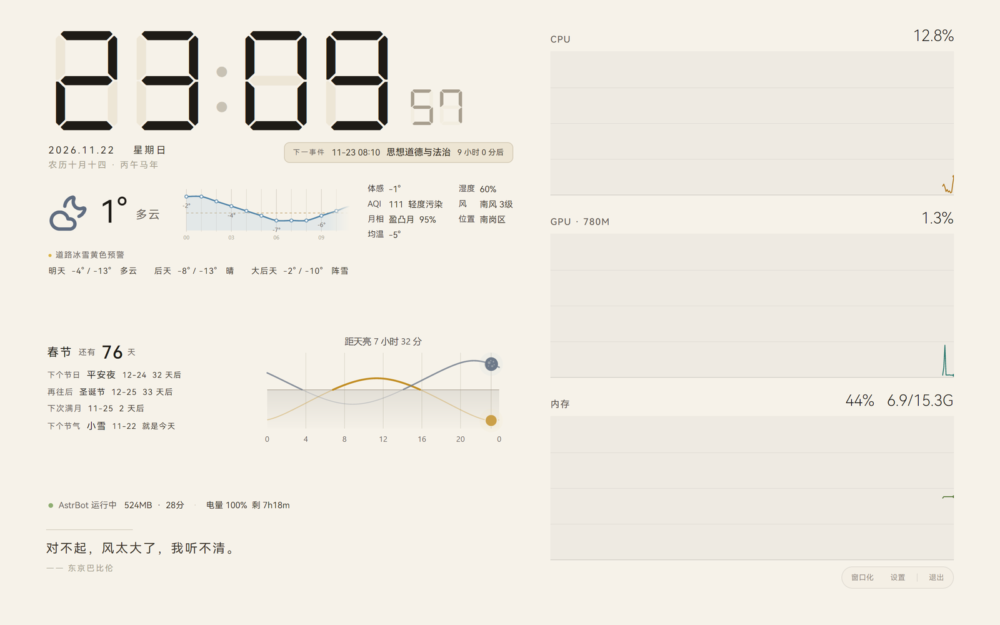

# 夜板 NightBoard

挂在屏幕上的信息板。无边框、深色、安静，适合副屏常驻或当屏保。



日间主题（默认跟随日出日落自动切换）：



## 显示内容

- **时间**：大字号时:分:秒，七段数码管字体，冒号随秒闪动；下面一行公历日期、星期、农历与干支
- **天气**：图标、温度、天况；逐小时温度曲线可横向滚动；体感、湿度、AQI、风向风级、月相、均温、城市
- **三日预报**：明天 / 后天 / 大后天的高低温与天况
- **预警**：一行彩色等级点，点开看正文
- **日程**：读取「文档」目录下的 `.ics`，显示正在进行或下一件事，带剩余时间
- **倒计时**：节日（公历 + 农历 + 母亲节/父亲节 + 除夕 + 清明）、再往后的一个节日、下次满月、下一个节气
- **日月轨迹**：按当前经纬度实时计算太阳与月亮的地平高度；纵轴按当天极值自适应，天体不会跑出画面
- **硬件曲线**：CPU、每一张 GPU、内存的实时占用；显卡被系统关掉时自动隐藏卡片
- **状态行**：AstrBot 运行状态、内存与运行时长、电量与剩余时间

## 运行环境

- Windows 10 1903 及以上 / Windows 11，64 位
- [.NET 10 运行时](https://dotnet.microsoft.com/download/dotnet/10.0)

解压后双击 `NightBoard.exe`。首次启动会按 IP 猜一个城市，猜错了在设置里搜索修改。

## 快捷键

| 键 | 作用 |
| --- | --- |
| `F11` | 全屏 / 窗口化切换 |
| `Esc` | 退出全屏 |
| `S` | 打开设置 |
| `T` | 手动切换深色 / 浅色 |
| `A` | 切换「跟随时间自动换主题」 |
| `-` / `+` | 调暗 / 调亮 |

## 构建

需要 .NET 10 SDK。

```bash
dotnet build -c Release
dotnet run -c Release
```

打包成可分发目录（依赖目标机安装 .NET 10 运行时）：

```bash
dotnet publish -c Release -r win-x64 --self-contained false -o publish
```

## 数据来源

| 数据 | 来源 |
| --- | --- |
| 天气、逐小时、预警 | 小米天气接口 |
| IP 定位（仅用于猜城市） | ip-api.com |
| 日程 | 本地 `.ics` 文件 |
| 农历、节日、节气、月相、日月高度 | 本地计算，不联网 |

断网时沿用上次缓存的天气。

## 目录结构

```
Controls/     自绘控件：日轨图、小时曲线、迷你折线、天气图标
Services/     天气、天文、节日、节气、农历、日历、硬件采样、设置
MainWindow    主界面与布局
SettingsWindow 设置窗口
Assets/       字体与图标
```

## 字体

- HarmonyOS Sans SC（界面正文）
- DSEG7 Classic（数码管时钟）
- Lucide（图标）

均为可自由分发的开源字体，随程序打包在 `Assets/Fonts`。

## 关于 AI 生成

本项目的代码**大量由 AI 辅助生成**，需要明确说明：

- 界面绘制、天文与节气算法、数据抓取、打包流程等，绝大部分由 AI 起草
- 每一版都由人工审阅、实机运行、逐项修正后提交；截图均来自实际运行
- 天文计算参照公开公式实现，但测试覆盖有限，不保证任何场景下都精确
- 代码按「现状」提供，不附带任何明示或暗示的担保

如果打算用在关键场景，请自行评估并补充测试。

## License

[GNU General Public License v3.0](LICENSE)（GPL-3.0-only）。

你可以自由使用、修改、分发，但衍生作品需同样以 GPLv3 开源，且不提供任何担保。
